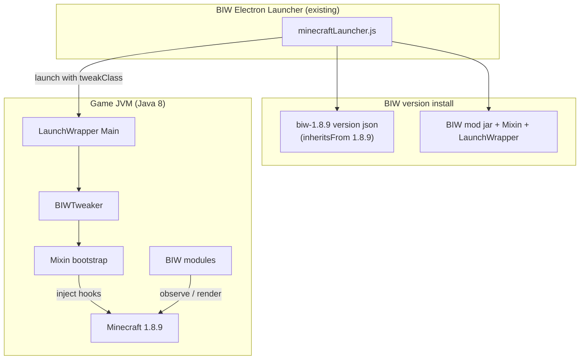
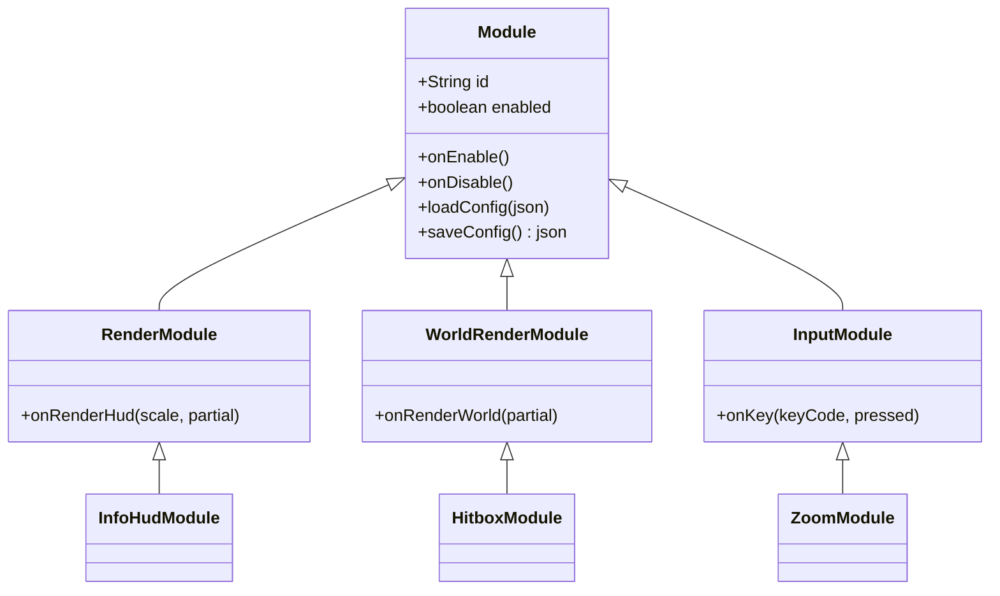

# Design Document — BIW Mod (Minecraft 1.8.9)

## Overview

BIW Mod is a client-side modification for Minecraft 1.8.9 (Java Edition) that
adds a small set of visual and quality-of-life features: a hitbox outline, a
lightweight info HUD, and a zoom key. It is a separate Java project from the
existing Electron launcher (`BIW Client`); the launcher is extended to install
and launch the modded version.

The first milestone is intentionally small: get a working mod loader plus the
Hitbox feature rendering in-game. HUD and Zoom follow once the loader is solid.

### Goals

- A working 1.8.9 mod loader on a maintained stack (LaunchWrapper tweaker +
  SpongePowered Mixin), not written from scratch.
- Hitbox outline module (draw an outline around entities' existing bounding
  boxes).
- A lightweight info HUD (FPS, optional coords/ping) and a Zoom key.
- Launch the modded version from the BIW Electron launcher.

### Design principles

- **Lightweight first.** Modules only observe state and render. No background
  threads, no per-frame allocations in the render loop, no packet sending.
  The mod should not measurably hurt frame times.
- **Small, composable modules.** Each feature is an independent module that can
  be toggled and configured.
- **Fail safe.** A failing module is disabled, never crashes the game.

## Stack choices

| Concern | Choice | Reason |
|---|---|---|
| Language/build | Java 8 + Gradle | 1.8.9 runs on Java 8. |
| Deobfuscation | MCP/Searge mappings (loom legacy or ForgeGradle 2.x) | 1.8.9 classes are obfuscated (`ave`, `fgo`, ...). |
| Bootstrap | LaunchWrapper + custom Tweaker | Same entry mechanism Forge 1.8.9 uses. |
| Patching | SpongePowered Mixin 0.7.x | Clean bytecode injection. |
| Config | JSON via Gson (bundled with MC) | Simple, editable. |

## Architecture (High-Level Design)

### Component diagram



### Launch flow

```mermaid
sequenceDiagram
  participant L as BIW Launcher
  participant LW as LaunchWrapper
  participant TW as BIWTweaker
  participant MX as Mixin
  participant MC as Minecraft

  L->>LW: java ... Launch --tweakClass com.biw.BIWTweaker
  LW->>TW: injectIntoClassLoader()
  TW->>MX: MixinBootstrap.init() + addConfiguration(biw.mixins.json)
  TW-->>LW: getLaunchTarget() = net.minecraft.client.main.Main
  LW->>MC: launch with game args
  MX->>MC: apply mixins as classes load
  MC->>MC: game runs; modules render/observe
```

### Module model



## Project structure

```text
biw-mod/                          (new Java/Gradle project)
  build.gradle
  settings.gradle
  gradle.properties               (MC version, mappings, mixin version)
  src/main/java/com/biw/
    BIWTweaker.java               LaunchWrapper ITweaker entry
    BIWMod.java                   Core init: registry, config, event bus
    core/
      Module.java
      ModuleManager.java
      EventBus.java
      Config.java
    event/
      RenderHudEvent.java
      RenderWorldEvent.java
      KeyEvent.java
    modules/
      HitboxModule.java
      InfoHudModule.java
      ZoomModule.java
    mixin/
      MixinGuiIngame.java         render HUD overlay
      MixinEntityRenderer.java    render-world hook + fov for zoom
  src/main/resources/
    biw.mixins.json
    assets/biw/...
```

## Low-Level Design

### BIWTweaker (LaunchWrapper entry)

```java
public final class BIWTweaker implements ITweaker {
    private final List<String> args = new ArrayList<>();

    @Override
    public void acceptOptions(List<String> args, File gameDir,
                              File assetsDir, String profile) {
        this.args.addAll(args); // pass vanilla args through unchanged
    }

    @Override
    public void injectIntoClassLoader(LaunchClassLoader cl) {
        MixinBootstrap.init();
        Mixins.addConfiguration("biw.mixins.json");
        MixinEnvironment.getDefaultEnvironment().setSide(Side.CLIENT);
    }

    @Override public String getLaunchTarget() {
        return "net.minecraft.client.main.Main";
    }

    @Override public String[] getLaunchArguments() {
        return args.toArray(new String[0]);
    }
}
```

### Event hooks via Mixin

HUD overlay hook:

```java
@Mixin(GuiIngame.class)
public class MixinGuiIngame {
    @Inject(method = "renderGameOverlay", at = @At("RETURN"))
    private void biw$onRenderHud(float partial, CallbackInfo ci) {
        BIWMod.EVENTS.post(new RenderHudEvent(partial));
    }
}
```

World render hook (used by Hitbox) and FOV hook (used by Zoom):

```java
@Mixin(EntityRenderer.class)
public class MixinEntityRenderer {
    @Inject(method = "renderWorldPass", at = @At("RETURN"))
    private void biw$onRenderWorld(int pass, float partial, long ns, CallbackInfo ci) {
        BIWMod.EVENTS.post(new RenderWorldEvent(partial));
    }

    @Inject(method = "getFOVModifier", at = @At("RETURN"), cancellable = true)
    private void biw$zoom(float partial, boolean useFov, CallbackInfoReturnable<Float> cir) {
        float m = BIWMod.MODULES.get(ZoomModule.class).fovMultiplier();
        if (m != 1f) cir.setReturnValue(cir.getReturnValueF() * m);
    }
}
```

### HitboxModule

```java
public final class HitboxModule extends WorldRenderModule {
    float lineWidth = 2.0f;
    int color = 0xFFFFFFFF;

    @Override public void onRenderWorld(float partial) {
        Minecraft mc = Minecraft.getMinecraft();
        if (mc.theWorld == null) return;
        for (Entity e : mc.theWorld.getLoadedEntityList()) {
            if (!(e instanceof EntityLivingBase)) continue;
            AxisAlignedBB box = e.getEntityBoundingBox(); // existing bounds
            drawOutline(interpolate(box, e, partial), color, lineWidth);
        }
    }
}
```

### InfoHudModule

```java
public final class InfoHudModule extends RenderModule {
    boolean showFps = true, showCoords = false, showPing = true;
    int x = 4, y = 4;

    @Override public void onRenderHud(int scale, float partial) {
        Minecraft mc = Minecraft.getMinecraft();
        List<String> lines = new ArrayList<>();
        if (showFps)    lines.add(Minecraft.getDebugFPS() + " FPS");
        if (showCoords && mc.thePlayer != null) lines.add(coords(mc.thePlayer));
        if (showPing)   lines.add(ping(mc.thePlayer) + " ms");
        drawStack(lines, x, y);
    }
}
```

### ZoomModule

```java
public final class ZoomModule extends InputModule {
    private boolean active;
    float level = 4f;
    int key = Keyboard.KEY_C;

    @Override public void onKey(int keyCode, boolean pressed) {
        if (keyCode == key) active = pressed; // hold to zoom
    }
    public float fovMultiplier() { return active ? 1f / level : 1f; }
}
```

### Config persistence

```jsonc
// %APPDATA%/biw-client/minecraft/config/biw.json
{
  "modules": {
    "hitbox": { "enabled": true, "color": "#FFFFFF", "lineWidth": 2.0 },
    "infohud": { "enabled": true, "showFps": true, "showCoords": false,
                 "showPing": true, "x": 4, "y": 4 },
    "zoom": { "enabled": true, "level": 4.0, "key": 46 }
  }
}
```

## Launcher integration

The launcher writes a version JSON that inherits from 1.8.9 and adds the BIW
libraries + the LaunchWrapper tweak class.

```jsonc
// versions/biw-1.8.9/biw-1.8.9.json (written by the launcher)
{
  "id": "biw-1.8.9",
  "inheritsFrom": "1.8.9",
  "type": "release",
  "mainClass": "net.minecraft.launchwrapper.Launch",
  "minecraftArguments": "... --tweakClass com.biw.BIWTweaker",
  "libraries": [
    { "name": "net.minecraft:launchwrapper:1.12" },
    { "name": "org.spongepowered:mixin:0.7.11-SNAPSHOT" },
    { "name": "com.biw:biw-mod:0.1.0" }
  ]
}
```

Changes in `minecraftLauncher.js`:

- After installing vanilla `1.8.9`, ensure `biw-1.8.9` exists: write the
  version JSON, place the BIW libraries under `libraries/`, then resolve with
  `Version.parse(gameDir, 'biw-1.8.9')`.
- A launcher option `modded: true` selects `biw-1.8.9`.
- Java selection unchanged: 1.8.9 uses `jre-legacy` (Java 8).

## Build & distribution

```text
gradle build  ->  build/libs/biw-mod-0.1.0.jar   (classes + biw.mixins.json + assets)
```

The launcher bundles this jar and copies it into the Minecraft
`libraries/com/biw/biw-mod/0.1.0/` layout referenced by the version JSON.

## Error handling

- Mixin apply failure: Tweaker logs it; game continues vanilla, affected module
  disabled, no crash.
- Each module's render/observe callback wrapped in try/catch; one failure never
  breaks the render loop or other modules.
- Config load failure falls back to defaults and rewrites a clean file.
- Launcher: missing `biw-1.8.9` JSON or libraries are reinstalled before
  launch; a clear error is shown if the mod jar is absent.

## Testing strategy

- **Unit (JUnit)**: `Config` load/save round-trip; `Zoom` fov math; HUD line
  formatting.
- **Mixin apply test**: headless check that `biw.mixins.json` targets resolve
  against 1.8.9 mappings (fails fast on obfuscation drift).
- **Launcher integration (Node)**: generated `biw-1.8.9` JSON parses with
  `@xmcl/core` `Version.parse` and includes `mainClass` + tweakClass.
- **Manual smoke test**: launch `biw-1.8.9` offline; confirm hitbox outlines
  draw, HUD renders, and zoom works while the key is held.

## Performance budget

- Hitbox: iterate loaded entities once per world-render pass; reuse buffers,
  no per-entity allocation. Target < 0.3 ms added frame time at typical entity
  counts.
- HUD: build at most a few short strings per frame; no allocation-heavy
  formatting in hot path.
- No extra threads, timers, or network I/O introduced by any module.

## Correctness properties (for the tasks phase)

1. **Config round-trip**: `parse(serialize(cfg)) == cfg` for arbitrary valid
   configs.
2. **Zoom fov**: `fovMultiplier()` is in `(0, 1]`, and equals `1` when inactive.
3. **Hitbox safety**: rendering with `theWorld == null` or an empty entity list
   does nothing and never throws.

## Open questions / assumptions

- Assumes JDK 8 is available for building the mod.
- 1.8.9 mappings (MCP stable) must be pinned; the exact Gradle plugin
  (legacy loom vs ForgeGradle 2.x) is decided in the first task.
- HUD/Zoom land after the loader + Hitbox milestone is verified in-game.
